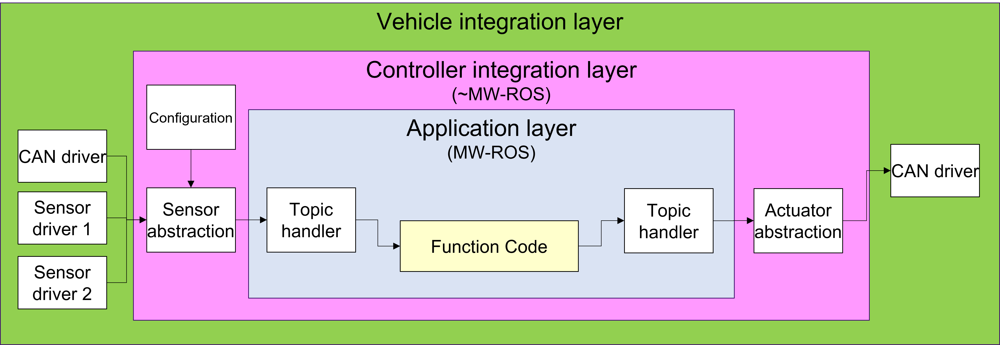
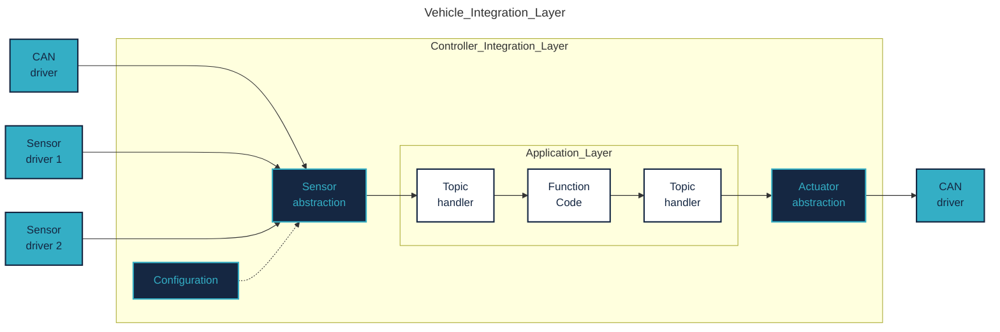

# Cooperative Research Platform
[](https://github.com/jkk-research/CooperativeResearchPlatform/actions/workflows/build_test.yml)
## Overview
This platform is developed and maintained by University of Győr - Vehicle Research Center in cooperation with ZalaZONE Innovation Park. The project is supported by Robert Bosch Engineering Center Budapest.\
<br />

<br />
\
**Our mission: to provide end-to-end vehicle control solutions to cover multiple driving scenarios, special focus on use-cases defined by industrial needs, utilizing cutting edge solution in terms communication, sensing, planning and control.**\
\
The platform is designed to be independent from any vehicle platform but providing a so called vehicle integration layer to adapt external signals to the controller based software components.\
We use ROS2 as middle-ware.





## Core repository and vehicle integrations
This repository contains the vehicle-independent core of the platform. Vehicle integrations (drivers, vehicle launchers, vehicle configuration and recording scripts) live in separate repositories:
- [CooperativeResearchPlatform_Lexus](https://github.com/jkk-research/CooperativeResearchPlatform_Lexus)

Core layout:
- `crp_APL`: planners, controllers, their interfaces and utilities, the `crp_msgs` submodule and the Foxglove layouts
- `crp_SIL`: sensor abstraction and late fusion
- `launch/apl_launcher`: `apl.launch.py` starts the planners and controllers
- `launch/sil_launcher`: `sil.launch.py` starts the sensor abstraction and fusion

To build, clone the repository with its submodules into the `src/` folder of a ROS 2 Humble colcon workspace and run the build scripts. They install the dependencies with rosdep and build from the workspace root:
```bash
git clone --recurse-submodules https://github.com/jkk-research/CooperativeResearchPlatform.git src/CooperativeResearchPlatform
source /opt/ros/humble/setup.bash
src/CooperativeResearchPlatform/scripts/build_APL.sh
src/CooperativeResearchPlatform/scripts/build_SIL.sh
```
The Autoware message packages (`autoware_*_msgs`, `autoware_internal_planning_msgs`) and `autoware_lanelet2_extension` come from apt through rosdep; they are not submodules.
